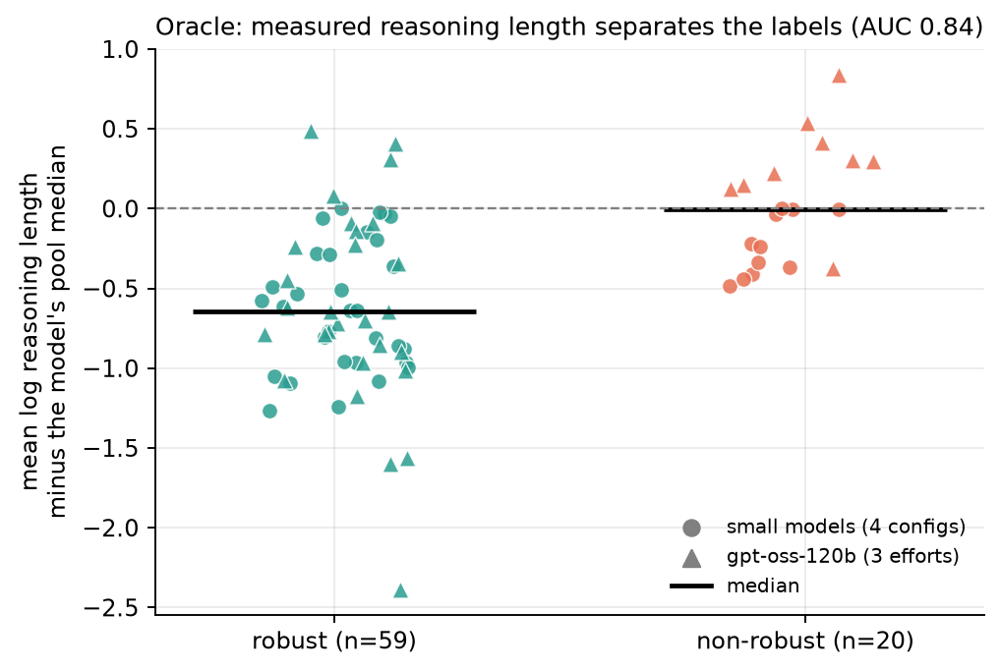
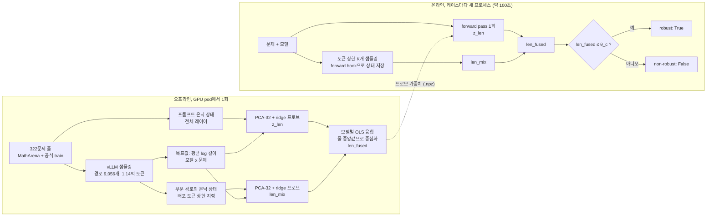
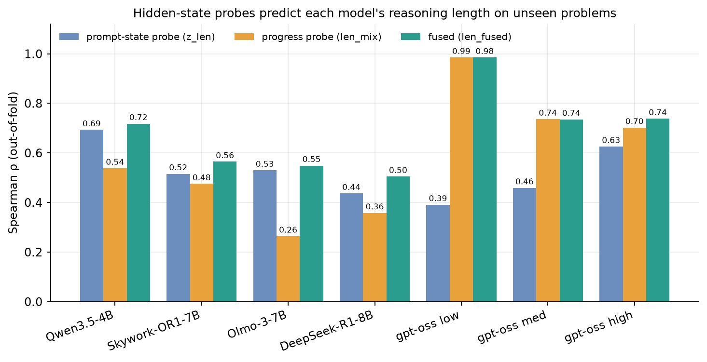
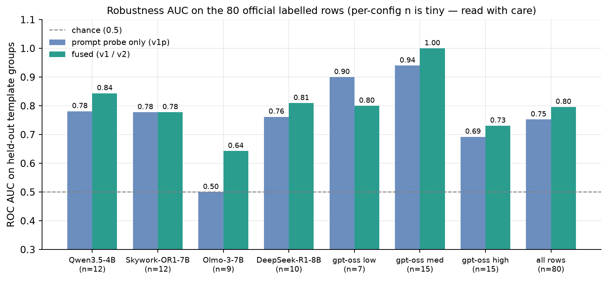
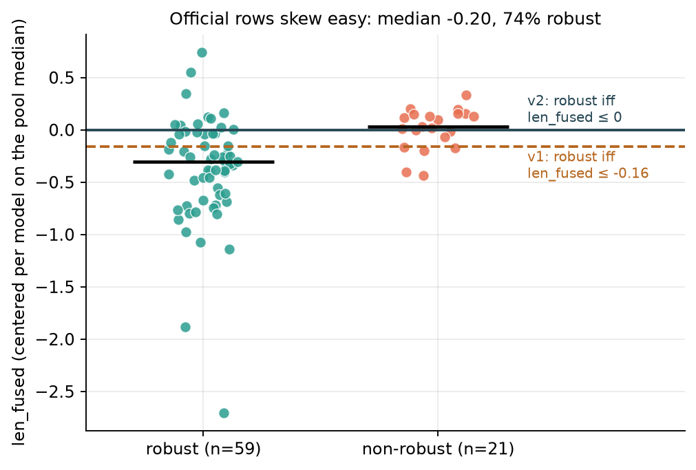
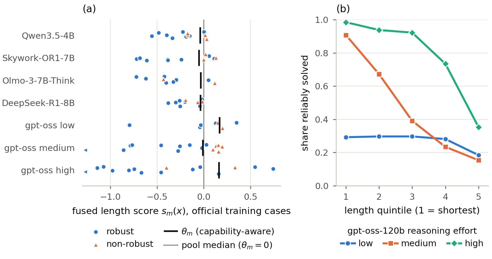

<div align="center">

# 🔎 은닉 상태(hidden state)에서 강건성을 읽어내다

### NeurIPS 2026 **AIMO Interpretability Challenge** 화이트박스 솔루션

*추론 모델의 내부 활성(activation)만으로, 수학 문제를 바꿔 말하거나(rephrase) 이름을 바꾸거나 방해 문장·오타를 넣어도 그 모델의 정답이 유지될지 예측합니다.*

<br>

[](https://aimo-interp.github.io/)
[](#1-대회-소개)
[](#3-방법)
[](requirements.txt)
[](LICENSE)

[English](README.md) · **한국어**

</div>

> **한 문단 요약.** 대회는 "추론 모델 + 수학 문제" 쌍마다, 문제를 변형해도 모델의 정확도가 유지되는지를 맞히라고 합니다.
> 우리는 공식 *robust / non-robust* 라벨이 사실상 **"그 문제가 그 모델에게 얼마나 어려운가"** 를 읽어낸 값이며, 모델 자신의
> **추론 길이**가 그 어려움을 가장 날카롭고 연속적으로 보여 주는 척도임을 확인했습니다(오라클 AUC 0.84, 정답률은 0.63).
> 그래서 모델의 **은닉 상태**로 추론 길이를 예측합니다. 프롬프트에 대한 한 번의 forward pass, 그리고 제한 시간 안에 샘플링한
> 부분 추론 경로의 은닉 상태를 사용하고, 모델 고유의 평균 길이로 중심화한 뒤 모델별 임계값에서 자릅니다.
>
> **현황(2026-11-14).** 최종 제출물은 **v3-main**(Main 트랙)과 **v3-small**(Small 트랙)입니다. 기술 보고서는 11/4에 제출했고
> [`report/`](report/)에 있으며, 번들·아티팩트·스크립트와 그 근거가 되는 모든 결과가 이 저장소에 들어 있습니다. 아래 본문은 첫 버전(v1)부터
> 최종 버전(v3)까지 순서대로 서술합니다.

## 한눈에 보기

| | |
|---|---|
| **과제** | `are_robust(model_id, problems, reasoning_effort) -> list[bool]`. 5개 모델 / 7개 구성, 호출당 160초(최종 평가에서 강제), RTX PRO 6000 1장, 오프라인, 순정 `transformers` |
| **신호** | 은닉 상태 프로브(프롬프트 상태 프로브 + 진행(progress) 프로브). 라벨 없는 322문제 풀로 학습하며, 공식 라벨 80행은 규칙의 점수를 매기는 데만 사용 |
| **결정 규칙** | robust ⇔ 예측 추론 길이 ≤ 모델별 임계값. v1/v2는 풀 중앙값, **최종 v3**는 모델이 안정적으로 푸는 풀 문제들 중 0.7분위수 |
| **최종 규칙 v3, 공식 80행**(점수만 매김, 적합 없음) | AUC **0.804**, 정확도 0.787, balanced accuracy **0.749** (v2: 0.762 / 0.716) |
| **화이트박스 소거 실험**(샘플이 있는 61행) | 은닉 상태 판독 AUC **0.82** 대 같은 샘플의 블랙박스 길이 추정 **0.60** (차이의 95% 신뢰구간 0.04~0.41) |
| **v1의 교차 검증**(80행, 템플릿 단위 분할) | AUC 0.796, balanced accuracy 0.734 (프롬프트 프로브만: 0.752 / 0.677) |
| **Codabench 검증, 최종 v3** | **Main 0.619 (13/21), Small 0.643 (9/14)**, 상수 기준선은 0.476 / 0.500. 검증 보드는 방법들을 가려내지 못합니다(표준오차 0.11 / 0.13): v3b 블랙박스 0.619 / 0.571, v3p 프로브 단독 0.667 / 0.571 |
| **생성한 데이터** | 추론 경로 9,056개, 1.14억 토큰, 7개 구성, 322문제. GPU 크레딧 약 $80 |
| **소요 시간** | v1·v2는 실시간 약 15시간(10/26 18:00 ~ 10/27 09:00 KST), v3와 보고서는 11/4까지, AI 코딩 에이전트와 함께 ([AI 사용 공개](#10-데이터-라이선스-준수-사항-ai-사용-공개)) |

<details>
<summary><b>목차</b></summary>

1. [대회 소개](#1-대회-소개)
2. [핵심 관찰](#2-핵심-관찰)
3. [방법](#3-방법)
4. [결과](#4-결과)
5. [안 된 것들](#5-안-된-것들)
6. [엔지니어링 교훈](#6-엔지니어링-교훈)
7. [저장소 구성](#7-저장소-구성)
8. [재현 방법](#8-재현-방법)
9. [한계와 다음 단계](#9-한계와-다음-단계)
10. [데이터, 라이선스, 준수 사항, AI 사용 공개](#10-데이터-라이선스-준수-사항-ai-사용-공개)
11. [타임라인](#11-타임라인)
12. [인용, 감사, 라이선스](#12-인용-감사-라이선스)

</details>

---

## 1. 대회 소개

[AIMO Interpretability Challenge](https://aimo-interp.github.io/)(NeurIPS 2026 competition track)는 정답을 알려 주지 않은 채
**robust(강건)** 한 수학 추론과 **spurious(허구적)** 추론을 구분하라는 과제입니다. 제출물은 다음 함수입니다.

```python
def are_robust(model_id: str, problems: list[str], reasoning_effort: str = "default") -> list[bool]: ...
```

모델 구성과 문제가 주어지면, 문제를 변형해도 그 모델의 정확도가 유지되는지를 판단합니다.

**라벨.** 주최 측은 (구성, 문제)마다 원문과 7개 변형군 -- *rephrase, rename, domain, distract, typos, expert perturbations,
expert no-solution* -- 으로 각각 약 10회 샘플링합니다(T = 1.0, top-k 40, top-p 0.95, 최대 10만 토큰).
`max_drop` = 원문 정확도 − 변형군 중 최저 정확도일 때:

| 라벨 | 규칙 | 공식 train 94행 |
|---|---|---:|
| robust | `max_drop <= 0.10` | 59 |
| non-robust (spurious) | `max_drop >= 0.25` | 21 |
| 무라벨, 채점 제외 | `0.10 < max_drop < 0.25` | 14 |

원문 정답이 일관되게 맞지 않는 케이스는 제외됩니다. 평가 지표는 단순 정확도입니다.

**모델.** Main 트랙은 오픈 웨이트 모델 5개를 7개 구성으로 평가하고, Small 트랙은 gpt-oss-120b를 뺍니다.

| 모델 | 구성 | 트랙 |
|---|---|---|
| Qwen/Qwen3.5-4B (thinking) | `default` | Main, Small |
| Skywork/Skywork-OR1-Math-7B | `default` | Main, Small |
| allenai/Olmo-3-7B-Think | `default` | Main, Small |
| deepseek-ai/DeepSeek-R1-0528-Qwen3-8B | `default` | Main, Small |
| openai/gpt-oss-120b (MXFP4 MoE) | `low`, `medium`, `high` | Main |

**설계를 좌우한 평가 규칙.**

* 함수는 **케이스마다 새 프로세스에서 한 번** 호출되고, 계획 단계에서는 import와 모델 로딩을 포함해 케이스당 약 **170초**였습니다.
  10/30에 주최 측이 최종 한도를 **호출당 160초**로 확정했고, 초과하면 오답으로 처리됩니다.
  네트워크 없음, 대회 이미지의 패키지(torch 2.12.1, transformers 5.13.0, vLLM 없음)만 사용, 공유 96GB RTX PRO 6000 1장.
  케이스 사이에 상태가 남지 않습니다.
* **검증(Codabench)**: Main 21 / Small 14케이스, 문제별·모델별로 *균형* 잡혀 있어 상수 예측이 약 0.48 / 0.50입니다.
  **테스트**: 트랙당 30~50케이스, 공개되지 않은 새 문제.
* **학습 데이터**: 36문제에 대한 94행 중 80행에 라벨이 있고 *그중 74%가 robust* -- 균형 잡힌 검증/테스트와 다릅니다.
* **화이트박스 상**(트랙별 +$1,000): 판정이 내부 신호(활성, 프로브, SAE, 개입)에 의존해야 합니다. 토큰 확률이나 엔트로피는
  해당하지 않습니다. 보고서에는 화이트박스 요소 유무 소거 실험이 필요합니다.
* 상금: Main $2,500 / $1,000 / $500, Small $1,500 / $700 / $300, 보고서 상 $4,000. 제출 단계는 연장되어 2026-11-02(12:00 UTC)에
  끝났고, 보고서 마감 11-05, 수상 결정 발표 11-15입니다. 참가자는 제출물 2개를 지정하며 최종 점수는 둘 중 더 좋은 쪽입니다.

이 저장소는 **검증 단계의 작업**을 기록합니다. 비공개 테스트 평가는 주최 측이 수행하며 여기서 재현하지 않습니다.

## 2. 핵심 관찰

**(1) 라벨은 모델별 신뢰도를 읽어낸 값입니다.** 주최 측 공개 샘플(다른 모델, 표면 변형군만)에서 원문 정확도가 1.0이던 케이스는
92%가 robust(n = 25), 0.8~0.9면 57%(n = 7), 0.7~0.8이면 25%(n = 4)였습니다. 변형군당 약 10회, 정답이 있는 6개 변형군이면
샘플당 신뢰도 0.95와 0.85만으로도 기대 라벨이 뒤집힙니다.

**(2) 문제만 보는 특징은 통하지 않습니다.** 공식 train 36문제 중 7개 구성에 걸쳐 라벨이 섞인 문제는 1개뿐이라 "문제가 얼마나
어려운가"는 train에서는 잘 맞지만, 검증 세트는 문제별·모델별로 균형이 맞춰져 있습니다. 필요한 신호는 **모델별 난이도**입니다.

**(3) 정답률은 포화되고, 추론 길이는 그렇지 않습니다.** 문제당 샘플이 4~6개면 모델이 풀 수 있는 문제는 대부분 매번 맞혀서
경험적 정답률은 상위 구간에서 정보가 거의 없습니다(라벨 대비 AUC **0.63**). 반면 추론의 *길이*는 연속적인 난이도 척도이고,
모델 고유의 평균 길이(문제 풀에 대한 중앙값)로 중심화하면 라벨을 AUC **0.84**로 구분합니다(중심화하지 않으면 0.68).

<p align="center"></p>

*그림 1. 공식 라벨 행마다 측정한 평균 log 추론 길이(모델의 풀 중앙값 기준 상대값). robust 행(청록)은 압도적으로 평균보다
짧고, non-robust 행(주황)은 평균 근처이거나 그 이상입니다. 이 "오라클"은 같은 문제에서 생성한 샘플을 사용하므로 길이 기반
예측기의 상한입니다.*

구성별 값입니다(한 구성 안에서 중심화는 상수 이동이라 AUC가 변하지 않으며, 정답률은 대부분의 구성에서 우연 수준에 가깝습니다).

| 구성 | 라벨 행 수 | 오라클 AUC, 추론 길이 | 오라클 AUC, 정답률 |
|---|---:|---:|---:|
| Qwen3.5-4B | 12 | 0.78 | 0.63 |
| Skywork-OR1-Math-7B | 12 | 0.93 | 0.50 |
| Olmo-3-7B-Think | 8 | 1.00 | 0.50 |
| DeepSeek-R1-0528-Qwen3-8B | 10 | 0.62 | 0.52 |
| gpt-oss-120b, low | 7 | 0.80 | 0.70 |
| gpt-oss-120b, medium | 15 | 1.00 | 0.80 |
| gpt-oss-120b, high | 15 | 0.81 | 0.46 |
| **전체**(길이는 모델별 중심화) | 79 | **0.84** | 0.63 |

(`python experiments/analyze_gen.py`가 이 표를 출력합니다. 구성별 n이 작아 개별 칸은 잡음이 큽니다.)

**(4) 따라서 목표는 모델의 상대 추론 길이이고, 이를 싸게 예측해야 합니다.** 테스트 시간 예산은 약 100초인데 Qwen3.5-4B나
DeepSeek-R1의 경로 하나가 2만 토큰이 넘으므로 길이를 *측정*할 수 없고 *예측*만 할 수 있으며, 그 지식이 담긴 곳이 모델의
은닉 상태입니다.

## 3. 방법



**프롬프트 상태 프로브(`z_len`).** 채팅 형식 프롬프트(주최 측의 풀이 지시문 + 문제)에 대한 forward pass 한 번. 모델마다 고른
한 레이어의 은닉 상태(마지막 프롬프트 토큰, 또는 문제 토큰들의 평균)를 표준화하고 주성분 32개로 투영한 뒤, ridge 회귀로 모델의
평균 log 추론 길이에 대응시킵니다(문제 풀로 학습하며 robust 라벨은 쓰지 않습니다).

**진행(progress) 프로브(`len_prog`).** 제출물은 K개의 추론 경로를 병렬로, 최대 수천 토큰까지만 샘플링합니다. forward hook이 마지막
decode 단계에서 각 경로의 은닉 상태를 기록합니다. 상한 전에 끝난 경로는 관측된 길이를, 아직 진행 중인 경로는 -- 바로 이런
부분 경로의 상태로 학습한 두 번째 프로브가 -- 앞으로 얼마나 더 길어질지 예측한 값을 제공합니다. 경로들의 평균을 모델의 풀 중앙값으로
중심화한 것이 `len_mix`입니다. **추가 연산이 들지 않고, 끝나는 경로가 하나도 없어도 동작합니다.** Qwen, Olmo, DeepSeek이 바로 그
경우입니다([METHOD.md](docs/METHOD.md#3-progress-probe-len_prog)).

**융합과 결정.** 구성마다 라벨 없는 풀에서 최소제곱(OLS)으로 두 추정을 결합해 풀 중앙값으로 중심화한 `len_fused`를 만듭니다.
v1과 v2는 **`len_fused`가 0 이하이면 robust**, 즉 모델의 풀 중앙값 이하로 판정했습니다. 검증/테스트가 모델별로 균형 잡혀 있기 때문입니다.

**능력 인지 임계값(v3, 최종).** 케이스는 모델이 일관되게 푸는 문제에만 존재하는데, 풀 중앙값은 모델이 못 푸는 문제도 함께
셉니다. 낮은 effort의 gpt-oss-120b가 그 이유를 보여 줍니다. 풀 전체에서 이 구성은 짧은 경로가 오히려 *덜* 자주 정답입니다(Spearman
$-0.20$, 다른 구성은 $+0.53$~$+0.97$). 낮은 effort는 못 푸는 문제에서도 일찍 멈추기 때문입니다. 그래서 v3는 임계값 $\theta_c$를,
해당 구성이 안정적으로 푸는 풀 문제들(완료된 샘플이 하나 이상이고 완료된 샘플이 모두 정답) 위에서 `len_fused`의 0.7분위수로 잡습니다.
그러면 gpt-oss low는 $+0.17$, high는 $+0.16$으로 옮겨 가고, 나머지 다섯 구성은 0에서 $0.06$ 이내에 머뭅니다. 공식 라벨에 적합하는
것은 없고, 라벨은 규칙의 점수만 매깁니다. 자세한 내용은 [METHOD.md](docs/METHOD.md#the-v3-rule-capability-aware-threshold)와 4.6절.

**안전장치.** `are_robust`는 예외를 던지지 않습니다(실패하면 상수 `True`). 샘플링이 실패하면 프롬프트 프로브로 대체하고,
메모리 부족 시 K를 절반으로 줄이며, 모든 단계에 벽시계 제한이 있습니다. 케이스마다 특징값과 시간만 담은 진단 한 줄을 출력하고
문제 텍스트는 절대 출력하지 않습니다.

전체 명세, 수식, 아티팩트 형식, 모델별 하이퍼파라미터: **[docs/METHOD.md](docs/METHOD.md)** (영어).

### 만든 버전들

| 버전 | 결정 규칙 | Codabench 검증 (Main / Small) |
|---|---|---|
| **v1p** | 프롬프트 상태 프로브만, `z_len <= -0.079`(공식 행으로 로지스틱 적합), **샘플링 없음** | 0.667 / 미실행 |
| **v1** | `len_fused <= -0.157`(공식 행으로 로지스틱 적합) | 0.571 / 미실행 |
| **v2** | `len_fused <= 0` -- v1에서 절편 제거 | 0.619 / 0.643 |
| **v3 (최종, 지정 제출물)** | `len_fused <= theta_c`, 위의 능력 인지 임계값 | **0.619 / 0.643** |
| v3b (소거) | 블랙박스: 같은 샘플, 검열 보정 길이 추정 `len_beh <= 0`으로 결정, 은닉 상태 미사용 | 0.619 / 0.571 |
| v3p (소거) | 프로브 단독: 프롬프트 상태 `z_len <= theta_z`, 샘플링 없음 | 0.667 / 0.571 |

모든 번들은 같은 코드(`src/`)를 담고 있으며 `.npz` 아티팩트만 다릅니다.

## 4. 결과

### 4.1 프로브는 처음 보는 문제의 추론 길이를 맞히는가?

풀에서 측정한 평균 log 길이와 예측값의 out-of-fold Spearman 상관(문제 템플릿 단위 5-fold):

<p align="center"></p>

| 구성 | 프롬프트 프로브 | 진행 프로브 | 융합 |
|---|---:|---:|---:|
| Qwen3.5-4B | 0.69 | 0.54 | **0.72** |
| Skywork-OR1-Math-7B | 0.52 | 0.48 | **0.56** |
| Olmo-3-7B-Think | 0.53 | 0.26 | **0.55** |
| DeepSeek-R1-0528-Qwen3-8B | 0.44 | 0.36 | **0.50** |
| gpt-oss-120b, low | 0.39 | 0.99 | **0.98** |
| gpt-oss-120b, medium | 0.46 | 0.74 | **0.74** |
| gpt-oss-120b, high | 0.63 | 0.70 | **0.74** |

두 프로브는 서로 보완적입니다. 경로가 상한 안에 끝나는 곳에서는 진행 프로브가(gpt-oss low는 60%가 끝나므로 추정치의 상당
부분이 *실측*), 아무것도 끝나지 않는 곳(Qwen, Olmo, DeepSeek: 상한 안에 끝나는 비율 0%)에서는 프롬프트 프로브가 우세합니다.
Olmo의 진행 프로브는 72문제뿐이라 약합니다.

### 4.2 robust 여부를 맞히는가?

공식 라벨 80행에 대한 반복(20회) 그룹 5-fold 교차 검증. 같은 문제 템플릿은 절대 fold를 가로질러 나뉘지 않습니다.

| 특징 | AUC | balanced acc. | accuracy | 행 수 |
|---|---:|---:|---:|---:|
| 프롬프트 프로브 `z_len` (v1p) | 0.752 | 0.677 | 0.660 | 80 |
| `z_len` + `len_prog`, 2-특징 로지스틱 | 0.811 | 0.704 | 0.700 | 76 |
| **융합 `len_fused`** (v1, v2) | **0.796** | **0.734** | **0.706** | 80 |
| *오라클: 측정된 상대 길이(생성 샘플 필요)* | *0.842* | *임계값 0에서 0.683* | *0.797* | *79* |

<p align="center"></p>

*그림 3. 같은 교차 검증의 구성별 AUC. 구성당 라벨 행이 7~15개뿐입니다. gpt-oss-low는 융합 후 오히려 낮아지고(0.90 → 0.80,
n = 7), Skywork은 같고, Qwen, Olmo, DeepSeek, gpt-oss-medium·high는 좋아집니다. 이 막대들은 전체 결과와 일치하는 정도로만
읽어야 하며 개별적으로 유의하다고 보지 않습니다.*

위 교차 검증은 라벨로 로지스틱 결정을 다시 적합합니다. 최종 규칙 v3는 라벨에 아무것도 적합하지 않습니다. 같은 80행에서 점수만 매기면
AUC 0.804(임계값과 무관해 v2와 같음), 정확도 0.787, balanced accuracy 0.749로, v2의 0.762 / 0.716보다 높습니다(4.6절).

### 4.3 소거 실험: 화이트박스 요소가 무엇을 더하는가?

제출물의 샘플러를 함께 돌린 공식 61행에서의 공정 비교(모든 특징 사용 가능):

| 특징 집합 | 은닉 상태 사용? | AUC | balanced acc. |
|---|:---:|---:|---:|
| `len_fused` (프롬프트 프로브 + 진행 프로브) | 예 | **0.811** | **0.736** |
| `len_beh`: 같은 샘플의 길이로 만든 검열(censored) 로그정규 추정 | 아니오 | 0.623 | 0.613 |
| `len_fused` + `len_beh` | 예 | 0.812 | 0.744 |
| 위에 블랙박스 정답 일치도 로짓을 추가 | 예 | 0.764 | -- |

블랙박스 길이 추정은 은닉 상태 특징 위에 아무것도 더하지 못하며(AUC +0.001), 이 토큰 예산에서는 5개 모델 중 4개에서 블랙박스
신호가 거의 비어 있습니다. 끝나지 않은 샘플의 은닉 상태가 완료율 정보를 포함하고, 정답 일치도 특징은 오히려 해롭습니다.
`z_len`에 정답률 프로브 `z_solve`를 더해도 교차 검증 AUC는 *떨어졌습니다*.

**최종 규칙으로 한 같은 소거 실험**(보고서 표 2. 같은 61행, 각 방법은 배포된 임계값 사용):

| 방법 | 은닉 상태 사용? | AUC | balanced acc. | 검증 Main / Small |
|---|:---:|---:|---:|---:|
| 같은 샘플의 블랙박스 길이 추정 (v3b) | 아니오 | 0.603 | 0.578 | 0.619 / 0.571 |
| 능력 임계값을 쓰는 프롬프트 프로브 `z_len` (v3p) | 예 | 0.790 | 0.719 | 0.667 / 0.571 |
| **융합 `len_fused` + 능력 임계값 (v3, 최종)** | 예 | **0.818** | **0.786** | **0.619 / 0.643** |

같은 샘플의 은닉 상태를 읽으면 AUC가 0.60에서 0.82로 올라가며, 차이의 95% 부트스트랩 구간(템플릿 그룹 재표집)은 0.04~0.41입니다.
프롬프트 프로브에 진행 프로브를 더한 효과는 잡음 범위 안입니다(구간 -0.09~0.13). 검증 보드에서는 세 방법이 한두 케이스 차이(35개 중
22 / 22 / 21)인데, 35케이스 보드로는 이를 가릴 수 없습니다. 화이트박스 요소의 근거는 검증 보드가 아니라 학습 행입니다.

### 4.4 Codabench 검증 (Main 21케이스, Small 14케이스)

| 번들 | 설명 | Main | Small |
|---|---|---:|---:|
| `baseline-always-true` | 공식 상수 기준선 | 0.476 (10/21) | 0.500 (7/14) |
| `v1p` | 프롬프트 상태 프로브만, 샘플링 없음, 임계값을 공식 행으로 적합 | 0.667 (14/21) | 미실행 |
| `v1` | 전체 화이트박스, 임계값을 공식 행으로 적합 | 0.571 (12/21) | 미실행 |
| `v2` | `v1`의 임계값을 풀 중앙값으로 변경 | 0.619 (13/21) | 0.643 (9/14) |
| **`v3`** | **최종**: 능력 인지 임계값(4.6절) | **0.619 (13/21)** | **0.643 (9/14)** |
| `v3b` | 블랙박스 소거: 같은 샘플, 은닉 상태 미사용 | 0.619 (13/21) | 0.571 (8/14) |
| `v3p` | 프로브 단독 소거, 능력 임계값 | 0.667 (14/21) | 0.571 (8/14) |

21(14)케이스에서 점수 하나의 표준오차는 약 0.11(0.13)이라 이 표의 모든 차이는 한두 케이스이며 보드로는 방법들의 순위를 가릴 수 없습니다.
최종 v3는 상수 기준선보다 표준오차 1.1~1.3배 높은데, 시사적일 뿐 유의하지는 않고, 35케이스로는 블랙박스·프로브 단독 소거 버전과도
구분되지 않습니다(정답 22 / 21 / 22). 참고로 10/26 시점 공개 리더보드에서 꾸준히 제출한 참가자(각 7~15회)의 Main 평균은
0.66~0.68이었고, 최고 점수(0.86, 18/21)는 20회 평균이 0.34인 참가자의 것이어서 노이즈의 최댓값입니다. 파이프라인은 평가 워커에서
문제없이 돌았습니다. 샘플링 실패 0건, **케이스당 88~104초**(Main 21케이스 전체 2,122초)로, 최종 평가가 강제하는 호출당 160초에
대해 약 55초의 여유가 있습니다. 제출별 상세, ID, 최종 제출 근거: [docs/SUBMISSION_LEDGER.md](docs/SUBMISSION_LEDGER.md).

### 4.5 v1이 0.571에 그친 이유: 라벨 없는 진단

v1 실행의 케이스별 stderr 로그(특징값과 시간만 기록)를 보면, 절반이 robust인 검증 세트에서 v1은 21개 중 **3개**만 "robust"로
예측했습니다.

<p align="center"></p>

* **특징은 정상이었습니다.** `len_fused`는 모델별 풀 중앙값으로 중심화되어 있고, 검증 21케이스에서의 중앙값은 +0.004로 균형 잡힌
  세트가 있어야 할 바로 그 자리입니다.
* **임계값이 문제였습니다.** v1은 로지스틱 절편을 74%가 robust이고 `len_fused` 중앙값이 −0.20인 공식 행으로 적합했기 때문에
  −0.157 아래일 때만 robust로 판정했습니다. 이는 검증 21케이스 중 18개의 왼쪽입니다. 주최 측 데이터 카드도 "이 유병률로 결정
  임계값을 보정하면 전이되지 않을 수 있다"고 경고합니다.
* **v2**는 기울기는 유지하고 절편을 제거합니다(`len_fused <= 0`). 이 변경은 검증 라벨을 쓰지 않았으며, 명시된 유병률 불일치에서
  도출했습니다(`experiments/make_v2_artifacts.py`). 같은 21개 특징 벡터에서 v2는 10개를 robust로 예측합니다.

참고로 프로브 단독 번들(v1p, 임계값 −0.079로 중앙값에 가까움)은 이미 균형에 더 가까웠고 점수도 더 높았습니다.
이후 v2는 Main 0.619, Small 0.643을 기록했습니다(4.4절).

### 4.6 최종 규칙: 능력 인지 임계값(v3)

v2는 모델별 임계값을 풀 중앙값에 두었습니다. 그런데 검증·테스트 케이스는 모델이 문제를 *일관되게* 푸는 경우에만 존재하고(주최 측이
나머지를 제외하므로 라벨을 기본 정확도로 읽어낼 수 없습니다), 풀 중앙값은 모델이 못 푸는 문제도 함께 셉니다. 어려운 문제에 빠르게
틀린 답을 내는 모델, 즉 낮은 effort의 gpt-oss-120b에서는 경계가 엉뚱한 곳에 놓입니다.

<p align="center"></p>

*그림 5(보고서의 그림 2). (a) 공식 학습 행(적합에 쓰이지 않음)의 융합 점수와 풀 중앙값 임계값(회색), 능력 인지 임계값(검정).
(b) 모델이 안정적으로 푸는 풀 문제의 비율(완료된 경로가 모두 정답)을 자신의 평균 추론 길이 5분위별로 본 것. gpt-oss의 medium·high에서는
짧은 경로가 안정적으로 푼 문제를 뜻하지만, low에서는 처음 네 분위에서 비율이 약 0.30으로 평평해 풀 전체에서는 길이가 안정성에 대한
신호를 주지 않습니다(정답률과 $-$길이의 Spearman: $-0.20$, 다른 구성은 $+0.53$~$+0.97$).*

모델이 안정적으로 푸는 문제로 한정하면 -- 케이스가 나오는 곳 -- 모든 구성에서 순서가 돌아옵니다. `len_fused`가 같은 문제에서 *다른* 모델들이
틀리는 비율과 양의 상관을 보입니다(gpt-oss low $+0.22$, 나머지 $+0.21$~$+0.68$). 그래서 규칙은 이 문제들 위에서 `len_fused`의 0.7분위수에
$\theta_c$를 둡니다.

| 구성 | Qwen | Skywork | Olmo | DeepSeek | gpt-oss low | gpt-oss medium | gpt-oss high |
|---|---:|---:|---:|---:|---:|---:|---:|
| $\theta_c$ (v2: 모두 0) | -0.04 | -0.05 | -0.03 | -0.04 | **+0.17** | -0.01 | **+0.16** |

공식 80행에서 점수만 매기면, 풀 중앙값에서 $\theta_c$로 옮겼을 때 정확도는 0.762에서 0.787로, balanced accuracy는 0.716에서 0.749로
올라갑니다. 2~3케이스 차이이므로 **v3의 근거는 점수가 아니라 메커니즘**입니다. $\rho = 0.7$은 라벨이 정보를 주는 유일한 숫자입니다.
일관되게 푼 학습 케이스의 자연 robust 비율(0.74)보다 약간 낮게 잡아 균형 잡힌 테스트 모집단 쪽으로 헤지한 값이며, $\rho$를 0.5~0.8로 바꾸면
balanced accuracy가 0.646~0.762 사이에서 움직입니다([METHOD.md](docs/METHOD.md#the-v3-rule-capability-aware-threshold)의 표).
그 밖에 공식 라벨에 적합한 것은 없습니다. v3를 v1p와 프로브 단독 v3p보다 고른 결정도 검증 보드가 아니라 학습 행에서 다시 확인했습니다
([장부](docs/SUBMISSION_LEDGER.md#why-v3-and-not-v1p-v2-or-v3p)).

## 5. 안 된 것들

| 시도 | 결과 |
|---|---|
| 정답률 프로브(`z_solve`)를 두 번째 특징으로 사용 | 샘플 4~6개에서는 정답률이 포화되어 교차 검증 AUC가 오히려 하락 |
| 블랙박스 예산 내 자기 일관성(완료율, 정답 일치도, 강제 답변) | 1.5~4k 토큰에서는 대부분의 경로가 끝나지 않음. Qwen은 검증 5케이스 모두에서 32개 중 0개 완료. 일치도 특징은 CV를 악화(0.764 vs 0.812) |
| 샘플 길이로 만든 검열 로그정규 길이 추정(`len_beh`) | AUC 0.62, 은닉 상태 특징 대비 이득 없음 |
| Leave-one-group-out CV | 약한 특징에 대해 심하게 비관적(이 n에서 합성 null 특징이 AUC 0.02~0.28). 모든 비교는 반복 그룹 5-fold 사용 |
| 프로브 하이퍼파라미터 탐색(PCA 16~64, ridge alpha, 레이어 조합) | Spearman 기준 최대 +0.03, 단순한 설정 하나 유지 |
| 공식 행으로 적합한 결정 임계값 | 균형 잡힌 모집단에 전이되지 않음(4.5절) |
| 합의 난이도 프로브: 다른 모델들의 z-점수 길이로 학습한 세 번째 융합 입력(`experiments/consensus_probe.py`) | 풀 상관은 DeepSeek에서만 올랐고(0.47 → 0.51) 학습 AUC는 0.803 → 0.820이지만 이는 비-robust Olmo 행 두 개에서 나온 것이며 정확도는 그대로. 사전에 정한 규칙으로 기각(로그 T5) |
| 진행 프로브 레시피 재조정(레이어 연결, PCA 32/64, ridge 10/100) | 구성별 최고 변형이 Spearman 0.01~0.05 개선되지만 9~12개 변형 중 최댓값이라 선택 편향이 있음. 채택하지 않음(로그 T8) |
| gpt-oss·Skywork에 더 긴 토큰 상한과 더 적은 샘플(GPU 재실행) | 블랙박스 길이 추정은 좋아지지만(gpt-oss medium: 3~4k 토큰에서 Spearman 0.66 → 0.90) 기대 이득은 트랙당 테스트 30~50케이스 중 0.1~0.3케이스이고, $30~40과 마감 위험이 따라 하지 않음(로그 T7, T9) |
| 검증 점수로 v1p, v2, v3, 소거 버전 중 선택 | 21케이스 점수 하나의 표준오차가 0.11이고 모든 차이가 한두 케이스. 선택은 학습 행으로 함(로그 S1, S2) |

## 6. 엔지니어링 교훈

세부 내용, 수치, 해결책은 **[docs/ENGINEERING_NOTES.md](docs/ENGINEERING_NOTES.md)** (영어)에 있습니다. 시간을 가장 많이 잡아먹은 것들:

* **DeepSeek-R1-0528-Qwen3-8B는 `AutoTokenizer`가 모든 공백을 조용히 지웁니다**(transformers 5.13, 5.19 모두). 프롬프트가 그럴듯해
  보이지만 깨져 있습니다. 솔루션은 토크나이저의 왕복(round-trip) 검사를 통과하는 것을 골라 씁니다(`aimo_robust.modeling`).
* **gpt-oss-120b는 `kernels`가 [0.15.2, 0.16) 범위일 때만 MXFP4로 직접 로드됩니다.** 다른 버전은 조용히 bf16으로 풀어서 메모리가
  부족해집니다. vLLM에서는 이 GPU에서 tensor-parallel 2와 `TRITON_ATTN` 백엔드가 필요합니다.
* **진짜 제약은 처리량입니다.** 순정 `generate`는 배치 32~64에서 초당 0.5~2.7k 토큰입니다. Qwen3.5-4B의 선형 어텐션 torch 대체
  구현은 배치에 비례해 느려지고, Olmo-3는 KV 헤드가 32개라 어텐션 병목입니다. 모델별 토큰 상한과 샘플 수는 측정한 ms/step으로 정했습니다.
* **잘림(truncation)**: Qwen 샘플의 61%, DeepSeek의 69%가 32k 상한에서도 잘려서 이들의 "길이"는 하한값입니다.
* **인프라**: 작은 멀티 GPU 작업 스케줄러, MTU 블랙홀을 통과하는 청크 SSH 업로드, 선불 크레딧이 줄었을 때의 예산 트리아지 --
  모두 `cloud/`에 있습니다.

## 7. 저장소 구성

```
.
├── README.md · README.ko.md · LICENSE · requirements.txt · requirements-runtime.txt
├── src/                                  제출물
│   ├── solution.py                       Codabench 진입점, 예외를 던지지 않음
│   └── aimo_robust/
│       ├── predict.py                    케이스별 파이프라인: 프로브 -> 예산 샘플링 -> 융합 -> 결정
│       ├── sampler.py                    K개 병렬 샘플, 데드라인, OOM 시 절반, forward hook, 블랙박스 특징
│       ├── prompting.py                  주최 측 풀이 프롬프트, 채팅 템플릿, 강제 답변 접미사, 답 파싱
│       └── modeling.py                   오프라인 로딩, 왕복 검사를 거친 토크나이저
├── experiments/                          CPU 쪽 파이프라인 (GPU 불필요)
│   ├── download_data.py · build_pool.py  공개 데이터셋 내려받기, 322문제 풀 구성
│   ├── analyze_gen.py · sweep_probe.py   오라클/잘림 점검, 프로브 탐색
│   ├── train_probe.py                    프롬프트 상태 프로브           -> z_len (및 z_solve)
│   ├── train_progress.py                 진행 프로브                    -> len_prog
│   ├── fuse.py                           모델별 융합 + 결정             -> len_fused, v1 아티팩트
│   ├── make_v2_artifacts.py              v2 규칙: 임계값을 풀 중앙값으로
│   ├── capability_threshold.py           v3 규칙(최종): 라벨 없는 능력 인지 임계값 -> runs/v3/art
│   ├── make_ablation.py                  블랙박스(v3b)·프로브 단독(v3p) 소거 아티팩트
│   ├── consensus_probe.py                시도했다가 기각한 모델 간 난이도 프로브
│   ├── fit_wb.py · fit_combiner.py       대체 결정 적합(화이트박스 전용 / 행동 특징 비교)
│   ├── build_submission.py               Main·Small 번들 빌드 (+ SHA-256 매니페스트)
│   ├── check_bundle.py · mock_predict_test.py   번들 점검: import / 가짜 모델로 결정 경로 확인(가중치 불필요)
│   ├── lb.py · parse_eval_log.py         리더보드 스냅샷, 평가 로그 진단
│   └── make_figures.py · cvutil.py       README 그림, 그룹 교차 검증
├── cloud/                                GPU 쪽 (RunPod): 생성, 은닉 상태, 벤치마크, 스케줄러
│   ├── gen_solve.py                      풀의 vLLM 샘플링                 extract_hidden.py    프롬프트 은닉 상태
│   ├── extract_progress.py               부분 경로 상태                   collect_behavior.py  train 케이스에서 샘플러 실행
│   ├── bench_hf.py · model_specs.py · check_tokenizers.py                 처리량, 사양, 토크나이저 왕복
│   ├── scheduler.py · after_job.sh · watch.sh · collect_final.sh · pod.sh 작업 큐와 pod 도우미
│   └── setup_pod.sh · download_models.sh · bootstrap_pod.sh · run_all.sh · jobs_*.jsonl
├── data/                                 README(출처, 라이선스) + pool_manifest.csv -- 문제 텍스트 없음
├── runs/                                 결과: 프로브 아티팩트(v1, v1p, v2, v3 + v3b / v3p 소거), 리포트 CSV, vLLM 샘플, 벤치마크
├── submissions/                          실제로 빌드한 번들 v1 ... v3 (+ SHA-256이 담긴 MANIFEST.md)
├── report/                               기술 보고서: 제출한 PDF, LaTeX 소스, 그림, 수치 스크립트
└── docs/
    ├── METHOD.md                         전체 명세, v3 규칙 포함 (영어)
    ├── ENGINEERING_NOTES.md              측정값, 장애 사례, 인프라 (영어)
    ├── SUBMISSION_LEDGER.md              계획, 규칙, 제출별 기록, 검증 요약, 최종 제출 (영어)
    ├── EXPERIMENT_LOG.md                 날짜별 실험 노트 (E, I, P, B, M, V, A, C, T, S, R 항목)
    ├── REPORT_NOTES.md                   초기 보고서 개요(최종 보고서는 report/)
    ├── cloud_gpu_manual.ko.md            RunPod 사용 안내 (한국어)
    └── figures/
```

## 8. 재현 방법

데이터 생성을 제외한 모든 것은 CPU에서 돌아갑니다.

```bash
git clone https://github.com/joon56/AIMO_-interpretability_challenge.git
cd AIMO_-interpretability_challenge
python -m venv .venv && source .venv/bin/activate        # Windows: .venv\Scripts\activate
pip install -r requirements.txt
```

**A. 결과 살펴보기 (몇 초).**

```bash
python experiments/make_figures.py                          # runs/v1/report로 docs/figures/*.png 재생성 (matplotlib 필요)
python experiments/make_v2_artifacts.py --art runs/v1/art_fused --out /tmp/v2_art   # runs/v2/art와 동일
```

**B. 데이터 재구성 (1분, 이 저장소에는 문제 텍스트가 없음).**

```bash
python experiments/download_data.py --build                  # 공식 train 행 + MathArena 16개 세트 -> data/pool/problems*.jsonl
python experiments/analyze_gen.py --gen runs/pod/runs/gen    # 공개된 샘플의 오라클 AUC, 잘림, 정답률 통계
```

재구성한 풀과 원본 파일 17개는 실험에 쓴 파일과 바이트 단위로 동일합니다.

**C. 프로브 재학습 (은닉 상태 1.1GB 필요, git에는 없음).** GPU 스크립트(D절)로 다시 만들거나, 이 단계를 건너뛰고 `runs/`의
공개 아티팩트를 사용하세요.

```bash
python experiments/train_probe.py    --gen runs/pod/runs/gen --hidden runs/pod/runs/hidden --art runs/v1/art_probe --report runs/v1/report
python experiments/train_progress.py --gen runs/pod/runs/gen --progress runs/pod/runs/progress --art runs/v1/art_probe --out runs/v1/art_prog --report runs/v1/report
python experiments/fuse.py           --report runs/v1/report --art runs/v1/art_prog --out runs/v1/art_fused    # CV 표 출력
python experiments/make_v2_artifacts.py --art runs/v1/art_fused --out runs/v2/art
```

**D. 제출 번들 빌드와 점검.**

```bash
python experiments/build_submission.py --art runs/v2/art --name v2-rebuild --note "threshold at the pool median"   # -> submissions/v2-rebuild-{main,small}.zip
mkdir /tmp/v2s && cd /tmp/v2s && unzip /path/to/submissions/v2-small.zip
PYTHONPATH=. python /path/to/experiments/check_bundle.py v2-small                   # requirements-runtime.txt 필요
```

케이스를 직접 돌리려면 로컬 Hugging Face 캐시에 체크포인트가 있고 GPU가 있어야 합니다(로더는 대회와 같이 오프라인 전용):
`python -c "from solution import are_robust; print(are_robust('Qwen/Qwen3.5-4B', ['<문제 텍스트>'], 'default'))"`.
공식 ingestion/scoring 프로그램은 주최 측 [`getting-started`](https://github.com/aimo-interp/getting-started) 저장소를 사용하세요.

**D2. 최종(v3) 아티팩트와 보고서 수치 재구성 (CPU, 몇 초. B단계의 풀 필요).**

```bash
python experiments/capability_threshold.py --art runs/v2/art --rho 0.7 --out /tmp/v3_art   # runs/v3/art와 동일 (공식 행에서의 rho 탐색표 출력)
python experiments/make_ablation.py --art /tmp/v3_art --mode blackbox  --out /tmp/v3b_art  # runs/v3b/art와 동일
python experiments/make_ablation.py --art /tmp/v3_art --mode probeonly --out /tmp/v3p_art  # runs/v3p/art와 동일
python experiments/mock_predict_test.py submissions/v3-main.zip submissions/v3-small.zip   # 지정 번들의 결정 경로, 가중치 불필요 (requirements-runtime.txt의 torch)
python report/report_numbers.py                                                           # 보고서의 모든 수치 -> report/numbers.json
```

2026-11-14에 이 저장소의 파일만으로 확인했습니다. 세 아티팩트 묶음은 배열 단위로 재현되고(각각 266, 196, 175개 배열이 동일),
`report_numbers.py`는 `numbers.json`의 145개 값을 모두 재현하며, 모든 번들의 SHA-256이 `submissions/MANIFEST.md`와 일치합니다.

**E. GPU 데이터 재생성 (RunPod 4 x RTX PRO 6000 pod 기준 약 $80).**
[docs/ENGINEERING_NOTES.md](docs/ENGINEERING_NOTES.md#5-gpu-data-generation-compute-cost-and-scheduling)를 참고하세요. 요약하면,
pod의 `/workspace/claude`에 저장소를 두고:

```bash
bash cloud/setup_pod.sh                 # venv 2개: 런타임 미러(torch 2.12.1, transformers 5.13.0) + vLLM 0.32.0
bash cloud/run_all.sh                   # 모델 다운로드, vLLM 샘플링, 프롬프트 은닉 상태, 처리량 벤치마크
# 진행 상태, 행동 샘플, Olmo/DeepSeek 부분집합: 실제 실행한 작업은 cloud/jobs_*.jsonl에 있음
# (bootstrap_pod.sh <jobs 파일>이 그 작업들로 cloud/scheduler.py를 시작)
```

## 9. 한계와 다음 단계

* **라벨 데이터가 매우 적습니다.** 80행, 33문제, 템플릿 그룹 27개. 최종 결정 규칙에는 자유 파라미터가 하나, $
ho = 0.7$이 있고
  학습 데이터의 유병률 0.74를 알고 정했습니다. CV 추정에는 큰 오차 범위가 있고(구성당 n이 7~15), 검증의 표준오차는 약
  0.11(Main) / 0.13(Small)입니다.
* **검증으로는 화이트박스 요소를 확인할 수 없습니다.** 그 근거는 샘플이 있는 학습 61행입니다(AUC 0.82 대 0.60, 구간 0.04~0.41).
  검증 35케이스에서는 블랙박스·프로브 단독 소거 버전이 최종 방법과 한 케이스 안쪽으로 붙어 있습니다.
* **분포 이동.** 프로브는 문제당 2~6개 샘플인 최근 올림피아드 문제 322개로 학습했습니다. 테스트 문제는 새 문제라 더 어렵거나 표현이
  다를 수 있습니다. 잘림(32k에서 Qwen 61%, DeepSeek 69%)은 길이 목표값을 아래쪽으로 치우치게 합니다.
* **데이터 불균형.** DeepSeek은 144문제에 n = 2, Olmo는 108문제(진행 상태는 72문제). 이 둘의 프로브가 가장 약합니다.
* **예산이 제한된 샘플링.** 케이스당 약 100초면 1.5~4k 토큰만 디코딩할 수 있어서, 5개 모델 중 4개에서는 경로 자체가 아니라 진행
  프로브가 신호를 담당합니다.
* **모델링하지 않은 것:** 테스트에 포함될 수 있는 `expert_no_solution` 변형군.
* **시도하지 못한 아이디어:** 잘린 문제의 64k 토큰 재샘플링, 마지막 단계 하나 대신 여러 토큰 위치의 은닉 상태 스냅샷, 모델별
  임계값을 풀 중앙값 쪽으로 수축(shrinkage), 레이어 앙상블, 더 강한 화이트박스 근거를 위한 인과적 개입(길이 방향 제거), 재샘플링
  라벨이 있는 더 큰 자체 변형 데이터셋, gpt-oss·Skywork에 더 긴 토큰 상한과 더 적은 샘플을 쓰는 방법(기대 이득이 테스트 0.1~0.3케이스라
  GPU 예산을 쓸 가치가 없다고 판단, 로그 T9).

## 10. 데이터, 라이선스, 준수 사항, AI 사용 공개

* **문제 텍스트는 재배포하지 않습니다.** MathArena 문제 세트는 CC BY-NC-SA 4.0이고 공식 학습 행의 라이선스는 `other`입니다. 둘 다
  필요할 때 내려받습니다(`experiments/download_data.py`, [data/README.md](data/README.md) 참조). 공개된 결과 파일은 문제를
  `pid`(해시)로만 가리킵니다. 이 저장소의 코드, 문서, 그림, 프로브 아티팩트는 MIT 라이선스입니다. 모델 가중치는 포함하지 않으며
  각자의 라이선스를 따릅니다.
* **라벨 탐색 금지 준수.** 이 작업 흐름은 제출 결과로 검증 라벨을 추정한 적이 없습니다. 기록된 제출마다
  [원장](docs/SUBMISSION_LEDGER.md)에 가설이 적혀 있고, 검증 문제는 출력하거나 저장한 적이 없으며(솔루션은 모델, 특징값, 시간만
  기록), 제출물은 네트워크를 쓰지 않고 `submissions/`에 문서화된 자원만 사용합니다.
* **검증 점수로 방법을 고르지 않았습니다.** 선택은 공식 행의 그룹 CV와 라벨 없는 풀로 했습니다. v2 임계값 변경은 라벨 없는 진단(4.5절)에서
  나왔고, 이 저장소는 그 사실을 그대로 밝힙니다. v3는 메커니즘으로 정하고 학습 행에서 점수를 매겼으며(4.6절), v1p와 프로브 단독 소거
  버전보다 v3를 고른 결정도 그 행들에서 다시 확인했습니다([장부](docs/SUBMISSION_LEDGER.md#why-v3-and-not-v1p-v2-or-v3p)). 모든 변형의
  검증 점수는 결과와 상관없이 4.4절에 적었습니다.
* **AI 지원 공개.** 이 프로젝트는 저장소 소유자가 AI 코딩 에이전트 **Claude Code(Anthropic)** 와 함께 수행했습니다. 연구, 구현,
  실험, GPU 오케스트레이션은 Claude Opus 5.5가, 이 저장소의 정리와 문서화는 Claude Sonnet 5.5가 맡았습니다. 에이전트가 사실상
  모든 코드를 작성하고 분석을 실행했으며 이 문서들을 자율적으로 작성했습니다. 소유자는 대회 자료를 제공하고, GPU pod를 대여하고,
  번들을 Codabench에 업로드하고, 계정 수준의 결정을 내렸습니다. 이 저장소의 모든 수치는 저장소 안의 스크립트로 만든 것입니다.

## 11. 타임라인

모든 시각은 KST입니다. 빈 폴더에서 채점된 제출물까지 약 15시간이 걸렸고, 그중 약 7시간이 GPU 생성이었습니다.

| 시각 | 내용 |
|---|---|
| 10/26 18:00 | 시작: 규칙과 공지 읽기, 공개 솔루션 저장소 12개 조사, 공식 데이터 분석 |
| 10/26 18:34 | 주최 측 테스트 큐에서 타이밍 측정: 콜드 스타트 5~9초, HF 디코딩 초당 0.7~1.8k 토큰 |
| 10/26 19:40~21:30 | 4-GPU RunPod pod 2대 가동, 7개 구성 전체에 대한 풀의 vLLM 샘플링 시작 |
| 10/26 20:00 | 승리 계획과 사전 등록 결정 규칙 D1~D6 |
| 10/26 22:27 | 평가 워커에서 프로브 + 샘플러 경로 런타임 테스트 |
| 10/26 23:00 | 진행 프로브 아이디어: 끝나지 않은 경로의 은닉 상태를 공짜로 활용 |
| 10/27 00:30 | 잔액 $19 시점의 예산 트리아지. 수명이 짧은 세 번째 pod가 마지막 Olmo 샤드를 밤새 처리 |
| 10/27 ~03:00 | 잔액 0, pod 정지. 데이터는 이미 모두 회수 |
| 10/27 04:27 | v1, v1p 번들 빌드 (CV AUC 0.796 / 0.752) |
| 10/27 07:57~08:49 | Codabench: v1 0.571, v1p 0.667. 라벨 없는 진단. 08:56 v2 빌드 |
| 10/28 01:22 | v3(능력 인지 임계값)와 블랙박스·프로브 단독 소거 버전 빌드. 모의 결정 경로 테스트 통과. 원본 데이터에서 CPU로 전체를 다시 돌려 아티팩트가 비트 단위로 재현됨 |
| 10/28~10/29 | Codabench: v2-main 0.619, v3-main 0.619, v3-small 0.643, v2-small 0.643, 블랙박스 소거 v3b 0.619 / 0.571 |
| 10/30 | 최종 제출 결정(v3-main + v3-small, 학습 행으로 v3 대 v1p 재확인). 주최 측이 한도를 호출당 160초로 확정 |
| 11/1~11/2 | Codabench에서 프로브 단독 소거 v3p 실행(0.667 / 0.571). 제출 단계는 11/2에 종료 |
| 11/4 | OpenReview에 기술 보고서 제출 |
| 11/13~11/14 | 저장소 공개(11/13), 최종 상태로 갱신: v3 번들·아티팩트, 보고서, 스크립트, 결과(11/14) |

## 12. 인용, 감사, 라이선스

이 작업을 사용하신다면 주최 측 요청대로 대회 논문을 인용하고 이 저장소를 링크해 주세요.

```bibtex
@article{stefanik2026aimointerp,
  author       = {Michal Stef{\'{a}}nik and Philipp Mondorf and Andreas Waldis and Qianying Liu and Chuan Yang and
                  Michal Spiegel and Josef Kuchar and Marek Kadlc{\'{\i}}k and Adam Vawda{-}Oomerjee and Chaoran Liu and
                  Simon Frieder and Barbara Plank and Fazl Barez and Pontus Stenetorp},
  title        = {{AIMO} Interpretability Challenge},
  journal      = {CoRR},
  volume       = {abs/2607.13899},
  year         = {2026},
  url          = {https://doi.org/10.48550/arXiv.2607.13899},
  doi          = {10.48550/ARXIV.2607.13899},
  eprinttype   = {arXiv},
  eprint       = {2607.13899}
}
```

**감사.** 과제, 데이터, 평가 인프라를 제공한 AIMO Interpretability Challenge 주최 측, 정제된 대회 문제를 제공한
[MathArena](https://matharena.ai/), Qwen3.5·Skywork-OR1·Olmo 3·DeepSeek-R1·gpt-oss 저자들, vLLM·Hugging Face `transformers`·
scikit-learn 프로젝트, GPU pod를 제공한 RunPod.

**라이선스.** 이 저장소의 코드, 문서, 그림, 프로브 아티팩트는 [MIT](LICENSE)입니다. 데이터셋과 모델 가중치는 각자의 라이선스를
따릅니다([data/README.md](data/README.md)).
