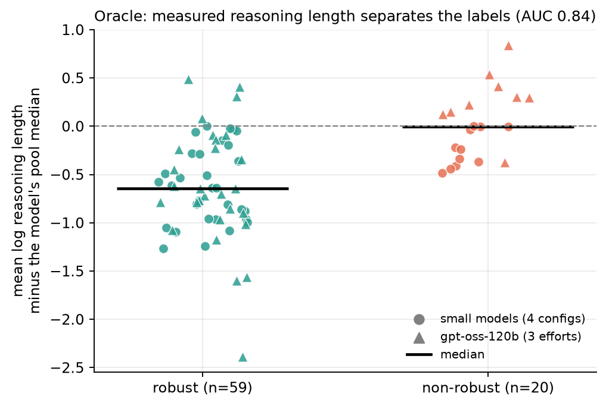
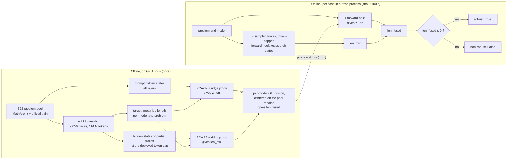
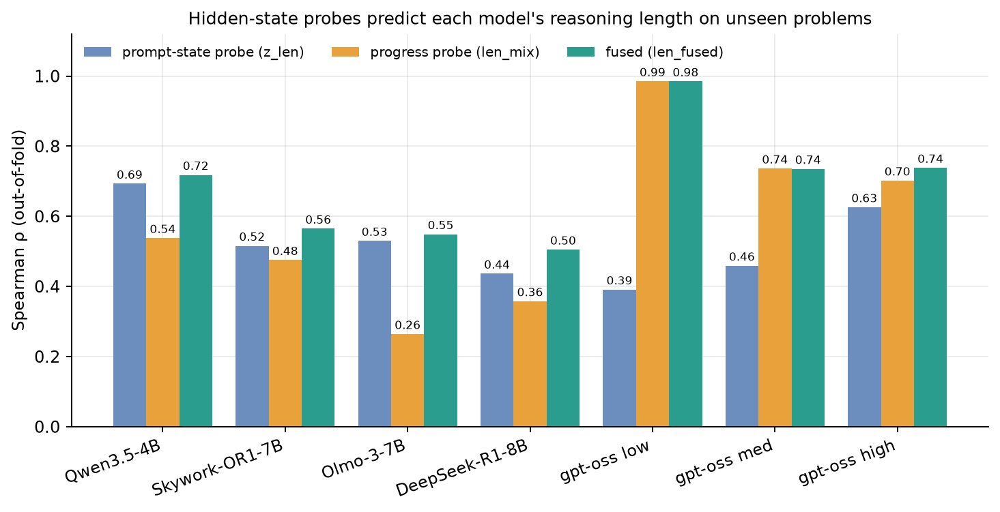
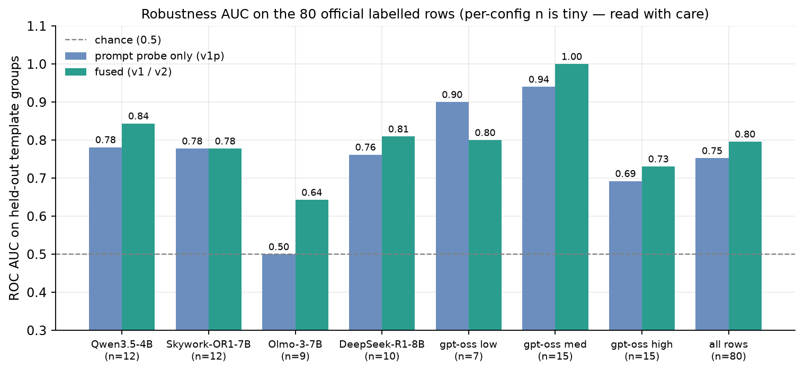
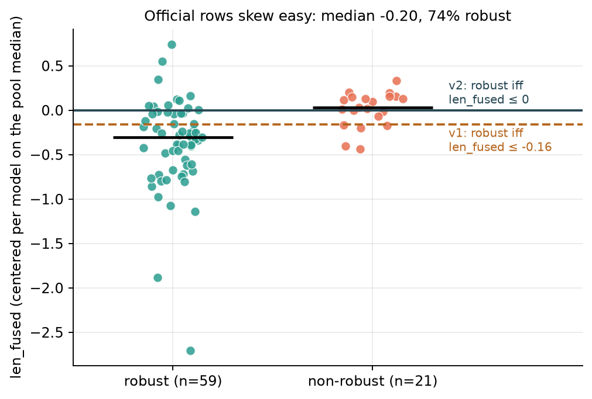

<div align="center">

# 🔎 Reading Robustness off the Hidden States

### A white-box solution to the NeurIPS 2026 **AIMO Interpretability Challenge**

*Predict, from a reasoning model's own activations, whether its answer to a math problem survives rephrasing, renaming, distractors and typos.*

<br>

[](https://aimo-interp.github.io/)
[](#1-the-challenge)
[](#3-method)
[](requirements.txt)
[](LICENSE)

**English** · [한국어](README.ko.md)

</div>

> **In one paragraph.** For a given reasoning model and a math problem, the challenge asks whether the model's accuracy will
> hold up when the problem is perturbed. We found that the official *robust / non-robust* label is mostly a readout of **how hard
> the problem is for that particular model**, and that the **length of the model's own reasoning** is a sharp, continuous
> measure of that difficulty (oracle AUC 0.84, versus 0.63 for the solve rate). So we predict each model's reasoning length
> from its **hidden states** -- one forward pass over the prompt, plus the hidden states of the partial reasoning traces it
> samples inside the time budget -- center it on the model's typical length, and cut at the median.

## At a glance

| | |
|---|---|
| **Task** | `are_robust(model_id, problems, reasoning_effort) -> list[bool]` for 5 models / 7 configurations, about 170 s per case on one RTX PRO 6000, offline, plain `transformers` |
| **Signal** | hidden-state probes (prompt-state probe + progress probe), trained on a label-free pool of 322 problems; only the final decision uses the 80 official labelled rows |
| **Decision** | robust $\Leftrightarrow$ predicted reasoning length $\le$ the model's pool median |
| **Cross-validation** (80 official rows, grouped by problem template) | AUC **0.796**, balanced accuracy **0.734**; prompt probe alone 0.752 / 0.677; black-box length estimate 0.62 |
| **Codabench validation, Main (21 cases)** | probe-only **0.667**, full white-box with a mis-set threshold 0.571, always-`True` baseline 0.476 (one standard error is about 0.11) |
| **Data generated** | 9,056 reasoning traces, 114 M tokens, 7 configurations, 322 problems, on about $80 of GPU credit |
| **Built in** | about 15 hours of wall-clock time (26 Oct 18:00 to 27 Oct 09:00 KST) together with an AI coding agent ([disclosure](#10-data-licenses-compliance-and-ai-disclosure)) |

<details>
<summary><b>Table of contents</b></summary>

1. [The challenge](#1-the-challenge)
2. [Key observations](#2-key-observations)
3. [Method](#3-method)
4. [Results](#4-results)
5. [What did not work](#5-what-did-not-work)
6. [Engineering lessons](#6-engineering-lessons)
7. [Repository map](#7-repository-map)
8. [Reproduce](#8-reproduce)
9. [Limitations and next steps](#9-limitations-and-next-steps)
10. [Data, licenses, compliance and AI disclosure](#10-data-licenses-compliance-and-ai-disclosure)
11. [Timeline](#11-timeline)
12. [Citation, acknowledgements, license](#12-citation-acknowledgements-license)

</details>

---

## 1. The challenge

The [AIMO Interpretability Challenge](https://aimo-interp.github.io/) (NeurIPS 2026 competition track) asks participants to
separate **robust** from **spurious** mathematical reasoning without being told the answer: a submission is a function

```python
def are_robust(model_id: str, problems: list[str], reasoning_effort: str = "default") -> list[bool]: ...
```

that judges, for a given model configuration and problem, whether the model's accuracy survives perturbations of the problem.

**Labels.** For every (configuration, problem) the organizers sample the model on the original problem and on perturbed copies
in seven families -- *rephrase, rename, domain, distract, typos, expert perturbations, expert no-solution* -- about ten samples
each (T = 1.0, top-k 40, top-p 0.95, 100k tokens). With `max_drop` = base accuracy minus the lowest family accuracy:

| label | rule | official train rows (94) |
|---|---|---:|
| robust | `max_drop <= 0.10` | 59 |
| non-robust (spurious) | `max_drop >= 0.25` | 21 |
| unlabelled, never scored | `0.10 < max_drop < 0.25` | 14 |

Cases whose base answer is not consistently correct are excluded. The scoring metric is plain accuracy.

**Models.** The Main track evaluates five open-weights models in seven configurations; the Small track drops gpt-oss-120b.

| model | configurations | tracks |
|---|---|---|
| Qwen/Qwen3.5-4B (thinking) | `default` | Main, Small |
| Skywork/Skywork-OR1-Math-7B | `default` | Main, Small |
| allenai/Olmo-3-7B-Think | `default` | Main, Small |
| deepseek-ai/DeepSeek-R1-0528-Qwen3-8B | `default` | Main, Small |
| openai/gpt-oss-120b (MXFP4 MoE) | `low`, `medium`, `high` | Main |

**Evaluation rules that shape the design.**

* The function is called **once per case in a fresh process**, with about **170 s per case** including imports and model load;
  no network, only the packages of the competition image (torch 2.12.1, transformers 5.13.0, no vLLM), one shared
  96 GB RTX PRO 6000. No state survives between cases.
* **Validation** (Codabench): 21 Main / 14 Small cases, *balanced* per problem and per model, so a constant guess scores about
  0.48 / 0.50. **Test**: 30-50 cases per track on new, unpublished problems.
* **Training data**: 94 rows over 36 problems, 80 of them labelled, *74% of those robust* -- unlike the balanced validation/test sets.
* **White-box award** (+$1,000 per track): the verdict must depend on internal signals (activations, probes, SAEs, interventions);
  token probabilities and entropy do not qualify. The report needs an ablation with and without the white-box part.
* Prizes: Main $2,500 / $1,000 / $500, Small $1,500 / $700 / $300, writeup prizes $4,000. Submissions closed 1 Nov 2026 (AoE),
  reports were due 5 Nov, award decisions are announced 15 Nov.

This repository documents the **validation-phase work**. The hidden test evaluation is run by the organizers and is not
reproduced here.

## 2. Key observations

**(1) The label is a readout of per-model reliability.** In the organizers' public sample (other models, surface families only),
cases with base accuracy 1.0 were robust 92% of the time (n = 25); with base accuracy 0.8-0.9 only 57% (n = 7), and with
0.7-0.8 only 25% (n = 4). With roughly ten samples per family and six answer-bearing families, a per-sample reliability of 0.95
versus 0.85 already flips the expected label.

**(2) A problem-only feature cannot work.** Of the 36 official training problems only one has mixed labels across the seven
configurations, so "how hard is this problem" scores well on the training set -- but validation is balanced per problem *and* per
model. The signal has to be **model-specific difficulty**.

**(3) The solve rate saturates, reasoning length does not.** With 4-6 samples per problem, most problems a model can solve are
solved every time, so the empirical solve rate carries little information at the top (AUC **0.63** against the labels). The
*length* of the reasoning is a continuous difficulty measure, and once it is centered on the model's own typical length (the
median over a pool of problems) it separates the labels with AUC **0.84** (0.68 without centering):

<p align="center"></p>

*Figure 1. Measured mean log reasoning length of each official labelled row, relative to its model's pool median. Robust rows
(teal) are overwhelmingly shorter than average; non-robust rows (orange) sit at or above it. This "oracle" uses the generated
samples of the same problem; it is the ceiling for any length-based predictor.*

Per configuration (inside one configuration centering is a constant shift, so it does not change the AUC; the solve rate is
close to chance for most of them):

| configuration | labelled rows | oracle AUC, reasoning length | oracle AUC, solve rate |
|---|---:|---:|---:|
| Qwen3.5-4B | 12 | 0.78 | 0.63 |
| Skywork-OR1-Math-7B | 12 | 0.93 | 0.50 |
| Olmo-3-7B-Think | 8 | 1.00 | 0.50 |
| DeepSeek-R1-0528-Qwen3-8B | 10 | 0.62 | 0.52 |
| gpt-oss-120b, low | 7 | 0.80 | 0.70 |
| gpt-oss-120b, medium | 15 | 1.00 | 0.80 |
| gpt-oss-120b, high | 15 | 0.81 | 0.46 |
| **pooled** (length centered per model) | 79 | **0.84** | 0.63 |

(`python experiments/analyze_gen.py` prints this table; the small per-configuration n makes single cells noisy.)

**(4) Therefore the target is the model's relative reasoning length -- and it has to be predicted cheaply.** The test-time budget
is about 100 s and a single trace of Qwen3.5-4B or DeepSeek-R1 is 20,000+ tokens long, so it cannot be measured, only
*predicted* -- and the model's hidden states are where that knowledge lives.

## 3. Method



**Prompt-state probe (`z_len`).** One forward pass over the chat-formatted prompt (the organizers' solve instruction plus the
problem). The hidden state at one layer -- the last prompt token or the mean over the problem tokens, chosen per model --
is standardized, projected on 32 principal components and mapped by ridge regression onto the model's mean log reasoning length
(trained on the pool, never on robustness labels).

**Progress probe (`len_prog`).** The submission samples K reasoning traces in parallel for at most a few thousand tokens. A forward
hook records the hidden state of every trace at the last decode step. A trace that finished before the cap contributes its
observed length; a trace that is still running contributes what a second probe -- trained on exactly such partial-trace states --
says about how long it will go on. The mean over traces, centered on the model's pool median, is `len_mix`. **It costs no extra
compute, and it still works when no trace finishes**, which is the case for Qwen, Olmo and DeepSeek (see
[METHOD.md](docs/METHOD.md#3-progress-probe-len_prog)).

**Fusion and decision.** Per configuration, an ordinary-least-squares fit on the label-free pool combines the two estimates into
`len_fused`, centered on the pool median. A single rule is shared by all seven configurations: **robust if `len_fused` is not
above zero** -- the model's pool median, because the validation and test sets are balanced per model.

**Safety rails.** `are_robust` never raises (any failure returns the constant `True`); a failed sampling pass falls back to the
prompt probe; an out-of-memory error halves K; every stage has a wall-clock deadline; each case prints one diagnostic line with
features and timing -- never problem text.

Complete specification, equations, artifact format and the per-model hyper-parameters: **[docs/METHOD.md](docs/METHOD.md)**.

### The versions we built

| version | decision | status |
|---|---|---|
| **v1p** | prompt-state probe only, `z_len <= -0.079` (logistic fitted on the official rows), **no sampling** | evaluated on Codabench Main |
| **v1** | `len_fused <= -0.157` (logistic fitted on the official rows) | evaluated on Codabench Main |
| **v2** | `len_fused <= 0` -- v1 with the intercept removed | built; its score is not recorded in this repository |

## 4. Results

### 4.1 Do the probes predict reasoning length on unseen problems?

Out-of-fold Spearman correlation between predicted and measured mean log length on the pool (grouped 5-fold CV by problem template):

<p align="center"></p>

| configuration | prompt probe | progress probe | fused |
|---|---:|---:|---:|
| Qwen3.5-4B | 0.69 | 0.54 | **0.72** |
| Skywork-OR1-Math-7B | 0.52 | 0.48 | **0.56** |
| Olmo-3-7B-Think | 0.53 | 0.26 | **0.55** |
| DeepSeek-R1-0528-Qwen3-8B | 0.44 | 0.36 | **0.50** |
| gpt-oss-120b, low | 0.39 | 0.99 | **0.98** |
| gpt-oss-120b, medium | 0.46 | 0.74 | **0.74** |
| gpt-oss-120b, high | 0.63 | 0.70 | **0.74** |

The two probes are complementary: the progress probe dominates where traces are short enough to finish inside the cap (gpt-oss
low: 60% finish, so the estimate is largely *measured*), the prompt probe where nothing finishes (Qwen, Olmo, DeepSeek:
0% inside the cap). Olmo's progress probe is weak (72 problems only).

### 4.2 Do they predict robustness?

Repeated (20x) grouped 5-fold cross-validation on the 80 official labelled rows; folds never split a problem template.

| features | AUC | balanced acc. | accuracy | rows |
|---|---:|---:|---:|---:|
| prompt probe `z_len` (v1p) | 0.752 | 0.677 | 0.660 | 80 |
| `z_len` + `len_prog`, two-feature logistic | 0.811 | 0.704 | 0.700 | 76 |
| **fused `len_fused`** (v1, v2) | **0.796** | **0.734** | **0.706** | 80 |
| *oracle: measured relative length (needs the generated samples)* | *0.842* | *0.683 at threshold 0* | *0.797* | *79* |

<p align="center"></p>

*Figure 3. Per-configuration AUC from the same cross-validation. Each configuration has only 7-15 labelled rows: gpt-oss-low
actually gets worse with fusion (0.90 to 0.80, n = 7), Skywork is unchanged, and Qwen, Olmo, DeepSeek, gpt-oss-medium and -high
improve. We read these bars as consistent with the pooled result, not as individually significant.*

### 4.3 Ablation: what does the white-box part add?

Fair comparison on the 61 official rows for which the submission's own sampler was also run (so every feature is available):

| feature set | reads hidden states? | AUC | balanced acc. |
|---|:---:|---:|---:|
| `len_fused` (prompt probe + progress probe) | yes | **0.811** | **0.736** |
| `len_beh`: censored log-normal length estimate from the same samples | no | 0.623 | 0.613 |
| `len_fused` + `len_beh` | yes | 0.812 | 0.744 |
| the above plus the black-box answer-agreement logit | yes | 0.764 | -- |

The black-box length estimate adds nothing on top of the hidden-state features (+0.001 AUC), and the black-box signals are close
to empty for four of the five models at this token budget. The hidden states of the unfinished samples subsume the finish-rate
information, and the answer-agreement feature hurts. Adding the solve-rate probe `z_solve` to `z_len` also *reduced*
cross-validated AUC.

### 4.4 Codabench validation (Main track, 21 cases)

| bundle | what it is | accuracy |
|---|---|---:|
| `baseline-always-true-main` | official constant baseline | 0.476 (0.48 on the board) |
| **`v1p-main`** | prompt-state probe only, no sampling | **0.667** (14/21) |
| `v1-main` | full white-box, threshold fitted on the official rows | 0.571 (12/21) |
| `v2-main` | `v1-main` with the threshold at the pool median | not recorded here |

With 21 cases a score has a standard error of about 0.11, so 0.571 and 0.667 are statistically indistinguishable from each other;
v1p is about 1.7 standard errors above the constant baseline. For scale: in the public leaderboard snapshot of 26 Oct, steady
participants (7-15 runs each) averaged 0.66-0.68 on Main, and the single best score (0.86, 18/21) belonged to a participant whose
20 runs averaged 0.34 -- a maximum of noise. v1 ran flawlessly on the evaluation worker: 0 sampling failures, **88-104 s per
case**, 2,122 s for all 21 cases. Per-submission details: [docs/SUBMISSION_LEDGER.md](docs/SUBMISSION_LEDGER.md).

### 4.5 Why v1 scored 0.571: a label-free diagnosis

The per-case stderr lines of the v1 run (features and timing only) show that v1 predicted "robust" for only **3 of 21** cases on
a validation set that is half robust:

<p align="center"></p>

* The **features were fine**: `len_fused` is centered on each model's pool median, and its median over the 21 validation cases is
  +0.004 -- exactly where a balanced set should sit.
* The **threshold was not**: v1 fitted the logistic intercept on the official rows, which are 74% robust and sit at median
  `len_fused` = -0.20, so it only called a case robust below -0.157. That is left of 18 of the 21 validation cases.
  The organizers' own dataset card warns that "calibrating a decision threshold on this prevalence may not transfer".
* **v2** keeps the slope and removes the intercept (`len_fused <= 0`). The change uses no validation label; it follows from the
  stated prevalence mismatch (`experiments/make_v2_artifacts.py`). On the same 21 feature vectors it predicts robust for 10.

Notably, the probe-only bundle (v1p, threshold -0.079, close to the median) was already closer to balanced and scored higher.

## 5. What did not work

| idea | outcome |
|---|---|
| Solve-rate probe (`z_solve`) as a second feature | with 4-6 samples the rate saturates; adding it lowered cross-validated AUC |
| Black-box budgeted self-consistency (finish rate, answer agreement, forced answers) | at 1.5-4k tokens most traces do not finish; Qwen finished 0 of 32 samples on 5 of 5 validation cases; agreement features hurt CV (0.764 vs 0.812) |
| Censored log-normal length estimate from the sampled lengths (`len_beh`) | AUC 0.62, no gain over the hidden-state features |
| Leave-one-group-out CV | strongly pessimistic for weak features (synthetic null features scored AUC 0.02-0.28 at this n); repeated grouped 5-fold is used for all comparisons |
| Probe hyper-parameter sweeps (PCA 16-64, ridge alpha, layer pairs) | at most +0.03 Spearman; kept one simple configuration |
| A decision threshold fitted on the official rows | did not transfer to a balanced population (section 4.5) |

## 6. Engineering lessons

Details, numbers and fixes are in **[docs/ENGINEERING_NOTES.md](docs/ENGINEERING_NOTES.md)**; the ones that cost the most time:

* **`AutoTokenizer` silently strips every space for DeepSeek-R1-0528-Qwen3-8B** in transformers 5.13 and 5.19 -- prompts look
  plausible but are garbled. The solution round-trip-checks the tokenizer and picks one that survives (`aimo_robust.modeling`).
* **gpt-oss-120b loads natively (MXFP4) only with `kernels` in [0.15.2, 0.16)**; any other version silently dequantizes to bf16
  and runs out of memory. In vLLM it needs tensor-parallel 2 and the `TRITON_ATTN` backend on this GPU.
* **Throughput is the real constraint**: plain `generate` gives 0.5-2.7k tokens/s at batch 32-64; Qwen3.5-4B's torch fallback for
  linear attention scales with batch size and Olmo-3's 32 KV heads make it attention-bound. The token caps and sample counts
  per model were fixed from measured ms/step.
* **Truncation**: 61% of Qwen and 69% of DeepSeek samples hit even a 32k-token cap, so "length" is a lower bound for them.
* **Infrastructure**: a tiny multi-GPU job scheduler, chunked SSH uploads through an MTU black hole, and budget triage when
  the prepaid credit ran low -- all in `cloud/`.

## 7. Repository map

```
.
├── README.md · README.ko.md · LICENSE · requirements.txt · requirements-runtime.txt
├── src/                                  the submission
│   ├── solution.py                       Codabench entry point, never raises
│   └── aimo_robust/
│       ├── predict.py                    per-case pipeline: probes -> budgeted sampling -> fusion -> decision
│       ├── sampler.py                    K parallel samples, deadline, OOM halving, forward hook, black-box features
│       ├── prompting.py                  organizers' solve prompt, chat templates, forced-answer suffix, answer parsing
│       └── modeling.py                   offline loading, round-trip-checked tokenizer
├── experiments/                          CPU-side pipeline (no GPU needed)
│   ├── download_data.py · build_pool.py  fetch public datasets, build the 322-problem pool
│   ├── analyze_gen.py · sweep_probe.py   oracle / truncation checks, probe sweeps
│   ├── train_probe.py                    prompt-state probes            -> z_len (and z_solve)
│   ├── train_progress.py                 progress probes                -> len_prog
│   ├── fuse.py                           per-model fusion + decision    -> len_fused, v1 artifacts
│   ├── make_v2_artifacts.py              v2 rule: threshold at the pool median
│   ├── fit_wb.py · fit_combiner.py       alternative decision fits (white-box only / behavioral comparison)
│   ├── build_submission.py               build the Main and Small bundles (+ SHA-256 manifest)
│   ├── check_bundle.py                   bundle sanity check
│   ├── lb.py · parse_eval_log.py         leaderboard snapshot, evaluation-log diagnostics
│   └── make_figures.py · cvutil.py       README figures, grouped cross-validation
├── cloud/                                GPU side (RunPod): generation, hidden states, benchmarks, scheduler
│   ├── gen_solve.py                      vLLM sampling of the pool        extract_hidden.py    prompt hidden states
│   ├── extract_progress.py               partial-trace states             collect_behavior.py  sampler on train cases
│   ├── bench_hf.py · model_specs.py · check_tokenizers.py                 throughput, specs, tokenizer round trip
│   ├── scheduler.py · after_job.sh · watch.sh · collect_final.sh · pod.sh job queue and pod helpers
│   └── setup_pod.sh · download_models.sh · bootstrap_pod.sh · run_all.sh · jobs_*.jsonl
├── data/                                 README (sources, licenses) + pool_manifest.csv -- no problem text
├── runs/                                 results: probe artifacts (v1, v1p, v2), report CSVs, vLLM samples, benchmarks
├── submissions/                          the exact bundles that were built (+ MANIFEST.md with SHA-256)
└── docs/
    ├── METHOD.md                         full specification
    ├── ENGINEERING_NOTES.md              measurements, failure modes, infrastructure
    ├── SUBMISSION_LEDGER.md              plan, rules, per-submission ledger, v1 diagnosis
    ├── EXPERIMENT_LOG.md                 dated lab notebook (E, I, P, B, M, V, A, C entries)
    ├── REPORT_NOTES.md                   early report outline
    ├── cloud_gpu_manual.ko.md            RunPod walkthrough (Korean)
    └── figures/
```

## 8. Reproduce

Everything except data generation runs on a CPU.

```bash
git clone https://github.com/joon56/AIMO_-interpretability_challenge.git
cd AIMO_-interpretability_challenge
python -m venv .venv && source .venv/bin/activate        # Windows: .venv\Scripts\activate
pip install -r requirements.txt
```

**A. Look at the results (seconds).**

```bash
python experiments/make_figures.py                          # regenerates docs/figures/*.png from runs/v1/report (needs matplotlib)
python experiments/make_v2_artifacts.py --art runs/v1/art_fused --out /tmp/v2_art   # identical to runs/v2/art
```

**B. Rebuild the data (a minute, no problem text is stored in this repo).**

```bash
python experiments/download_data.py --build                  # official train rows + 16 MathArena sets -> data/pool/problems*.jsonl
python experiments/analyze_gen.py --gen runs/pod/runs/gen    # oracle AUC, truncation and solve-rate statistics of the released samples
```

The rebuilt pool and all 17 source files are byte-identical to the ones the experiments used.

**C. Retrain the probes (needs the hidden states, 1.1 GB, not in git).** Regenerate them with the GPU scripts (section D) or
skip this step and use the released artifacts in `runs/`.

```bash
python experiments/train_probe.py    --gen runs/pod/runs/gen --hidden runs/pod/runs/hidden --art runs/v1/art_probe --report runs/v1/report
python experiments/train_progress.py --gen runs/pod/runs/gen --progress runs/pod/runs/progress --art runs/v1/art_probe --out runs/v1/art_prog --report runs/v1/report
python experiments/fuse.py           --report runs/v1/report --art runs/v1/art_prog --out runs/v1/art_fused    # prints the CV table
python experiments/make_v2_artifacts.py --art runs/v1/art_fused --out runs/v2/art
```

**D. Build and check a submission bundle.**

```bash
python experiments/build_submission.py --art runs/v2/art --name v2-rebuild --note "threshold at the pool median"   # -> submissions/v2-rebuild-{main,small}.zip
mkdir /tmp/v2s && cd /tmp/v2s && unzip /path/to/submissions/v2-small.zip
PYTHONPATH=. python /path/to/experiments/check_bundle.py v2-small                   # needs requirements-runtime.txt
```

To run a case you need the checkpoint in the local Hugging Face cache and a GPU (the loader is offline-only, as in the
competition): `python -c "from solution import are_robust; print(are_robust('Qwen/Qwen3.5-4B', ['<problem text>'], 'default'))"`.
For the official ingestion/scoring programs use the organizers' [`getting-started`](https://github.com/aimo-interp/getting-started) repository.

**E. Regenerate the GPU data (about $80 on RunPod, 4 x RTX PRO 6000 pods).** See
[docs/ENGINEERING_NOTES.md](docs/ENGINEERING_NOTES.md#5-gpu-data-generation-compute-cost-and-scheduling); in short, on a pod with the
repository at `/workspace/claude`:

```bash
bash cloud/setup_pod.sh                 # two venvs: runtime mirror (torch 2.12.1, transformers 5.13.0) + vLLM 0.32.0
bash cloud/run_all.sh                   # model download, vLLM sampling, prompt hidden states, throughput benchmarks
# progress states, behavior samples, and the Olmo/DeepSeek subsets: the exact jobs are in cloud/jobs_*.jsonl
# (bootstrap_pod.sh <jobs file> starts cloud/scheduler.py on them)
```

## 9. Limitations and next steps

* **Tiny labelled set.** 80 rows, 33 problems, 27 template groups. The decision has no free parameter left after v2, but the
  CV estimates carry wide error bars (per-configuration n of 7-15) and validation has a standard error of about 0.11.
* **Distribution shift.** The probes are trained on 322 recent olympiad problems with 2-6 samples each; test problems are new
  and may be harder or differently phrased. Truncation (61% Qwen, 69% DeepSeek at 32k) biases the length targets downward.
* **Uneven data.** DeepSeek has 144 problems with n = 2, Olmo 108 problems (progress states for 72); their probes are the weakest.
* **Budget-limited sampling.** At about 100 s per case only 1.5-4k tokens can be decoded, so the progress probe -- not the traces --
  carries the signal for four of five models.
* **Not modeled:** the `expert_no_solution` family, which the test set may contain.
* **Ideas not tried:** a 64k-token resample of truncated problems; snapshots of the hidden state at several token positions
  instead of the last step; per-model threshold shrinkage toward the pool median; ensembling layers; causal interventions
  (ablating the length direction) for stronger white-box evidence; larger self-built perturbation sets with resampled labels.

## 10. Data, licenses, compliance and AI disclosure

* **No problem text is redistributed.** MathArena problem sets are CC BY-NC-SA 4.0 and the official training rows carry the
  license `other`; both are downloaded on demand (`experiments/download_data.py`, see [data/README.md](data/README.md)). Released
  result files refer to problems by `pid` (a hash). The code, documentation, figures and probe artifacts here are MIT licensed.
  Model weights are not included and keep their licenses.
* **No label probing.** This workflow never used submissions to infer validation labels: each tracked submission has a stated
  hypothesis in [the ledger](docs/SUBMISSION_LEDGER.md); validation problems were never printed or stored (the solution logs only
  model, features and timing); the submission uses no network and only the documented resources in `submissions/`.
* **Validation was not used to select methods.** Selection used grouped CV on the official rows and the label-free pool. The v2
  threshold change followed from a label-free diagnosis (section 4.5), and this repository says so.
* **AI-assistance disclosure.** This project was carried out by the repository owner together with an AI coding agent, **Claude Code
  (Anthropic): Claude Opus 5.5 for the research, implementation, experiments and GPU orchestration, Claude Sonnet 5.5 for the
  packaging and documentation of this repository.** The agent wrote essentially all code, ran the analyses and drafted these
  documents autonomously; the owner supplied the competition materials, rented the GPU pods, uploaded the bundles to Codabench and
  made the account-level decisions. All numbers in this repository were produced by the scripts in it.

## 11. Timeline

All times KST. The pipeline from a blank folder to a scored submission took about 15 hours, of which about 7 were GPU generation.

| when | what |
|---|---|
| 26 Oct 18:00 | kickoff: read rules and announcements, survey 12 public solution repositories, analyze the official data |
| 26 Oct 18:34 | timing run on the organizers' test queue: cold start 5-9 s, HF decode 0.7-1.8k tokens/s |
| 26 Oct 19:40-21:30 | two 4-GPU RunPod pods up; vLLM sampling of the pool starts for all seven configurations |
| 26 Oct 20:00 | win plan and pre-registered decision rules D1-D6 |
| 26 Oct 22:27 | runtime test of the probe + sampler path on the evaluation worker |
| 26 Oct 23:00 | the progress-probe idea: use free hidden states of unfinished traces |
| 27 Oct 00:30 | budget triage with $19 left; a short-lived third pod finishes the last Olmo shard overnight |
| 27 Oct ~03:00 | balance reaches zero, pods stop; all data was already pulled |
| 27 Oct 04:27 | v1 and v1p bundles built (CV AUC 0.796 / 0.752) |
| 27 Oct 07:57-08:49 | Codabench: v1 scores 0.571, v1p 0.667; label-free diagnosis; 08:56 v2 built |

## 12. Citation, acknowledgements, license

If you use this work, please cite the challenge paper as the organizers ask, and link this repository:

```bibtex
@article{stefanik2026aimointerp,
  author       = {Michal Stef{\'{a}}nik and Philipp Mondorf and Andreas Waldis and Qianying Liu and Chuan Yang and
                  Michal Spiegel and Josef Kuchar and Marek Kadlc{\'{\i}}k and Adam Vawda{-}Oomerjee and Chaoran Liu and
                  Simon Frieder and Barbara Plank and Fazl Barez and Pontus Stenetorp},
  title        = {{AIMO} Interpretability Challenge},
  journal      = {CoRR},
  volume       = {abs/2607.13899},
  year         = {2026},
  url          = {https://doi.org/10.48550/arXiv.2607.13899},
  doi          = {10.48550/ARXIV.2607.13899},
  eprinttype   = {arXiv},
  eprint       = {2607.13899}
}
```

**Acknowledgements.** The AIMO Interpretability Challenge organizers for the task, data and evaluation infrastructure;
[MathArena](https://matharena.ai/) for the curated competition problems; the authors of Qwen3.5, Skywork-OR1, Olmo 3,
DeepSeek-R1 and gpt-oss; the vLLM, Hugging Face `transformers` and scikit-learn projects; RunPod for the GPU pods.

**License.** [MIT](LICENSE) for the code, documentation, figures and probe artifacts in this repository. Datasets and model weights
keep their own licenses ([data/README.md](data/README.md)).
